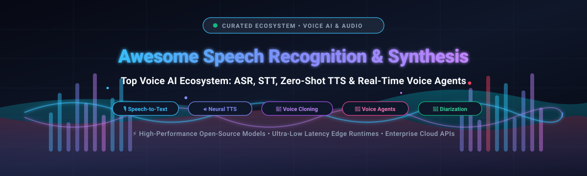
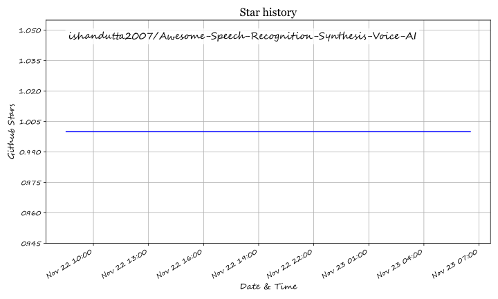

# 🎙️ Awesome Speech Recognition, Synthesis & Voice AI Ecosystem

<p align="center">
  
</p>

<p align="center">
  <a href="https://github.com/ishandutta2007/Awesome-Awesome-Awesome"></a>
  <a href="https://discord.gg/jc4xtF58Ve"></a>
  <a href="https://github.com/ishandutta2007/Awesome-Speech-Recognition-Synthesis-Voice-AI/stargazers"></a>
  <a href="https://github.com/ishandutta2007/Awesome-Speech-Recognition-Synthesis-Voice-AI/network/members"></a>
  <a href="https://github.com/ishandutta2007/Awesome-Speech-Recognition-Synthesis-Voice-AI/blob/main/LICENSE"></a>
  <a href="https://github.com/ishandutta2007"></a>
</p>

---

## 🌟 Overview & Quick Navigation

Welcome to the definitive, production-focused **Awesome Speech Recognition, Synthesis & Voice AI** directory! 🚀 Whether you are an AI researcher, speech scientist, audio machine learning engineer, or backend developer building real-time conversational agents, this curated repository indexes premier **SaaS/hosted developer APIs** and cutting-edge **open-source GitHub projects**.

Our coverage spans:
- 🎙️ **Automatic Speech Recognition (ASR / STT)**: High-accuracy batch audio transcription, low-latency WebSocket live streaming, multilingual speech foundation models, and edge inference.
- 🔊 **Text-to-Speech (TTS) & Neural Synthesis**: Expressive human-like prosody, multi-speaker dialogue generators, cross-lingual synthesis, and edge-optimized runtimes.
- 🧬 **Zero-Shot Voice Cloning & Voice Conversion**: Instant timbre matching from 3–5 second audio prompts, diffusion flow-matching, and speech-to-speech conversion.
- 🤖 **Conversational Voice Agents & Full-Duplex Audio**: Ultra-low-latency bidirectional turn-taking, speech-to-speech foundation architectures, and voice pipeline orchestration.
- 👥 **Audio Intelligence & Diarization**: Neural Voice Activity Detection (VAD), speaker diarization ("who spoke when"), emotion recognition, and noise suppression.

---

## 📑 Table of Contents
- [📊 Sector Overview & Market Dynamics](#-sector-overview--market-dynamics)
- [☁️ SaaS & Hosted Voice AI Platforms](#️-saas--hosted-voice-ai-platforms)
- [💻 Open-Source GitHub Projects](#-open-source-github-projects)
- [🛠️ Recommended Architecture & Local Voice AI Stack](#️-recommended-architecture--local-voice-ai-stack)
- [🤝 How to Contribute](#-how-to-contribute)
- [💖 Support & Sponsorship](#-support--sponsorship)
- [⚖️ Disclaimer & Ethics](#️-disclaimer--ethics)
- [📈 Star History](#-star-history)

---

## 📊 Sector Overview & Market Dynamics

The global **Speech Recognition, Speech Synthesis, and Conversational Voice AI** market is projected to reach between **$24 billion and $31 billion by 2026**, expanding rapidly at a compound annual growth rate (CAGR) of **15% to 23%** for core speech recognition and surpassing **30% to 39% CAGR** for generative voice AI and real-time voice agents.

The sector exhibits a **highly fragmented market dynamic** rather than a winner-take-all monopoly: while hyperscale cloud incumbents (Microsoft Azure, Google Cloud, AWS) and frontier foundation model labs (OpenAI) command extensive cloud compute and generalist multimodal workloads, specialized agile innovators (ElevenLabs, Deepgram, AssemblyAI, PlayHT) dominate enterprise niches through superior latency (sub-200ms TTFT), photorealistic emotional synthesis, granular developer APIs, and domain-adapted speech pipelines. Simultaneously, a burgeoning wave of permissible open-weights architectures (Whisper, Kokoro, CosyVoice, F5-TTS, Sherpa-ONNX) fuels widespread on-premise and local edge deployment.

---

## ☁️ SaaS & Hosted Voice AI Platforms

Below is an enterprise comparison of premier hosted Speech Recognition (STT), Speech Synthesis (TTS), and Conversational Voice AI platforms, sorted by **Valuation / Market Capitalization (descending)**.

| Platform | Category / Key Capabilities | Company Size (Valuation / Cap) | Pricing (Specific Starting Tiers) | Free Tier & Trial Limits |
| :--- | :--- | :--- | :--- | :--- |
| **[OpenAI Audio & Realtime API](https://openai.com)** | 🎙️ Foundational ASR (`whisper-1`, `gpt-transcribe`), Neural TTS & Full-Duplex Multimodal Speech-to-Speech API | **~$852B Valuation** (Private) / ~$50B Run-Rate ARR | **$0.006 / min** ($0.36 / hr) for Whisper STT; **$0.0045 / min** for `gpt-transcribe`; **$0.015 / 1K characters** (~$15 / 1M chars) for TTS-1; **$0.017 / min** for Realtime audio input | **$5.00 free credit grant** (valid for 3 months upon initial account verification; no free-forever tier) |
| **[Google Cloud Speech-to-Text & TTS](https://cloud.google.com/speech-to-text)** | 🌐 Scalable Cloud STT powered by Chirp foundation models (125+ languages) & Neural2 / Studio TTS synthesis | **~$2.1T Market Cap** (Parent: Alphabet Inc. - GOOGL) | **$0.016 / min** ($0.96 / hr) for standard STT V2; **$0.003 / min** ($0.18 / hr) for batch dynamic transcription; **$0.000016 / char** ($16 / 1M chars) for Neural2/Studio TTS | **60 audio minutes free every month forever** for STT + **4M characters free every month forever** for WaveNet/Standard TTS (+ $300 platform trial credit for 90 days) |
| **[Amazon Transcribe & Amazon Polly](https://aws.amazon.com/transcribe/)** | 🏢 Enterprise ASR with automated call analytics & Neural Text-to-Speech with SSML and streaming audio | **~$2.1T Market Cap** (Parent: Amazon.com Inc. - AMZN) | **$0.024 / min** ($1.44 / hr) for standard batch STT (drops to $0.015/min at scale); **$0.000016 / char** ($16 / 1M chars) for Amazon Polly Neural TTS | **60 audio minutes free every month for 12 months** (AWS Free Tier) for Transcribe + **5 million characters free every month for 12 months** for Polly |
| **[ElevenLabs](https://elevenlabs.io)** | 🧬 Industry-leading generative voice synthesis, instant & professional voice cloning, Scribe ASR & Conversational AI | **~$22B Valuation** (Private) / ~$600M ARR | **Starter Plan: $5 / mo** (billed annually, or $6/mo billed monthly) for 30,000 characters (~30 min audio) + commercial license; **Creator Plan: $22 / mo** (121,000 chars) | **10,000 credits/characters free forever every month** (~10 min audio; non-commercial license with required attribution, 3 custom voices) |
| **[Deepgram](https://deepgram.com)** | ⚡ Ultra-fast speech recognition (Nova-2 / Nova-3), conversational voice agent APIs & low-latency Aura TTS | **~$1.3B Valuation** (Private, Series C) / ~$50M+ ARR | **Pay-As-You-Go: $0.0043 / min** ($0.258 / hr) for Nova-2 pre-recorded STT; **$0.0059 / min** ($0.354 / hr) for Nova-2 streaming STT; **$0.030 / 1K characters** for Aura-2 TTS | **$200 in free API credits** (no credit card required, valid for lifetime of trial, grants ~770 hours of Nova-2 STT or 6.6M Aura characters) |
| **[AssemblyAI](https://assemblyai.com)** | 🧠 Speech AI developer platform: Universal-2 & Speech-to-Text 3.7, speaker diarization, audio intelligence & LeMUR | **~$300M Valuation** (Private) / ~$35M ARR | **Pay-As-You-Go: $0.15 / hr** ($0.0025 / min) for Universal-2 pre-recorded; **$0.21 / hr** ($0.0035 / min) for STT-3.7; **$0.30 / hr** for Streaming WebSocket STT | **$50 in free API credits** upon sign-up (no credit card required, covers ~238 to 333 hours of speech transcription) |
| **[Rev AI](https://rev.ai)** | 🎯 Enterprise transcription API featuring high accuracy, 40+ language translation, custom vocabulary & speaker diarization | **~$250M Valuation** (Private / Rev.com) / ~$12M+ ARR | **Pay-As-You-Go: $0.02 / min** ($1.20 / hr) for asynchronous transcription; **$0.024 / min** ($1.44 / hr) for streaming transcription; Human transcription at $1.50 / min | **5 hours of free transcription credits** ($20 value) for developers upon sign-up (consumer Rev web app offers 45 minutes free per month) |
| **[Otter.ai](https://otter.ai)** | 📝 AI meeting transcription assistant, live collaborative note-taking, automated summaries & action item extraction | **~$200M Valuation** (Private / $320M Funding & Debt) / ~$100M+ ARR | **Pro Plan: $8.33 / user / mo** (billed annually, or $16.99/mo billed monthly) for 1,200 transcription minutes/mo and 90 min max conversation length | **Basic Plan: Free forever with 300 transcription minutes / month** (capped at 30 min per conversation, plus 3 lifetime audio/video file imports) |
| **[Speechify](https://speechify.com)** | 📖 Consumer & studio AI text-to-speech reader, 1,000+ natural voices, OCR document scanning & AI dubbing | **~$100M+ Valuation** (Private) / Multi-Million Consumer ARR | **Premium Plan: $11.58 / mo** (billed annually at $139 / yr, or $29/mo billed monthly) with unlimited HD natural voices, OCR scanner, and up to 4.5x playback speed | **Free forever plan with 10 standard voices and up to 1.5x playback speed** (or a 3-day / 7-day all-access trial of Premium features) |
| **[PlayHT](https://play.ht)** | 🎭 Generative AI voice studio, conversational voice agents, expressive character TTS & zero-shot voice cloning | **~$50M Valuation** (Private, Play.ai) / ~$8M ARR | **Creator Plan: $39 / mo** (or $31.20/mo billed annually) for 250,000 characters / month (~5.5 hours audio), 10 instant voice clones, and commercial rights | **Free forever plan with 12,500 characters / month** and 1 instant voice clone (personal / non-commercial usage with attribution) |

---

## 💻 Open-Source GitHub Projects

Explore the most impactful open-source speech recognition engines, neural TTS architectures, voice conversion toolkits, and real-time voice agent frameworks. 

Every repository below features a live Stars_Badge linking directly to its GitHub stargazers page, sorted by **Stars_Count (descending)**.

| Repository | Focus & Primary Architecture | GitHub_Stars | License |
| :--- | :--- | :---: | :---: |
| **[VoiceStudio](https://github.com/debpalash/VoiceStudio)** | 🎙️ All-in-one desktop AI voice studio and workbench integrating leading TTS models, voice cloning engines, audio enhancement, and batch generation | [](https://github.com/debpalash/VoiceStudio/stargazers) | GPL-3.0 |
| **[OpenAI Whisper](https://github.com/openai/whisper)** | 🎯 Foundational Transformer ASR and speech translation model trained on 680,000+ hours of multilingual and multitask supervised audio | [](https://github.com/openai/whisper/stargazers) | MIT |
| **[GPT-SoVITS](https://github.com/RVC-Boss/GPT-SoVITS)** | 🧬 Powerful few-shot voice cloning and text-to-speech WebUI capable of zero-shot TTS from a 5-second sample or fine-tuning custom voice models in minutes | [](https://github.com/RVC-Boss/GPT-SoVITS/stargazers) | MIT |
| **[Real-Time Voice Cloning](https://github.com/CorentinJ/Real-Time-Voice-Cloning)** | 🧬 Pioneering deep learning framework for zero-shot multi-speaker text-to-speech voice cloning from 5 seconds of audio using SV2TTS | [](https://github.com/CorentinJ/Real-Time-Voice-Cloning/stargazers) | MIT |
| **[whisper.cpp](https://github.com/ggml-org/whisper.cpp)** | ⚡ High-performance, zero-dependency C/C++ port of OpenAI's Whisper model optimized for Apple Silicon (Metal), CUDA, Vulkan, OpenVINO, and edge devices | [](https://github.com/ggml-org/whisper.cpp/stargazers) | MIT |
| **[Coqui TTS](https://github.com/coqui-ai/TTS)** | 🔊 Deep learning toolkit for Text-to-Speech featuring XTTS-v2, VITS, YourTTS, and multilingual speech generation across 17+ languages with streaming | [](https://github.com/coqui-ai/TTS/stargazers) | MPL-2.0 |
| **[ChatTTS](https://github.com/2noise/ChatTTS)** | 💬 Conversational generative speech model designed specifically for dialogue scenarios, conversational agents, and natural interjections (laughter, sighs) | [](https://github.com/2noise/ChatTTS/stargazers) | CC-BY-NC-4.0 |
| **[Bark (Suno)](https://github.com/suno-ai/bark)** | 🎼 Transformer-based text-to-audio model by Suno generating expressive multilingual speech, background noise, music, and ambient audio cues | [](https://github.com/suno-ai/bark/stargazers) | MIT |
| **[RVC (Retrieval-based Voice Conversion)](https://github.com/RVC-Project/Retrieval-based-Voice-Conversion-WebUI)** | 🎭 Industry-leading real-time AI speech-to-speech voice conversion web studio with pitch extraction (Harvest/Crepe) and low-latency inference | [](https://github.com/RVC-Project/Retrieval-based-Voice-Conversion-WebUI/stargazers) | MIT |
| **[OpenVoice & OpenVoice V2](https://github.com/myshell-ai/OpenVoice)** | 🧬 Instant zero-shot voice cloning framework by MyShell providing granular control over emotion, accent, rhythm, pauses, and intonation | [](https://github.com/myshell-ai/OpenVoice/stargazers) | MIT |
| **[Fish Speech](https://github.com/fishaudio/fish-speech)** | 🐟 State-of-the-art dual-autoregressive speech synthesis architecture supporting zero-shot voice cloning across multilingual corpora without phoneme dependencies | [](https://github.com/fishaudio/fish-speech/stargazers) | CC-BY-NC-SA-4.0 |
| **[Chatterbox](https://github.com/resemble-ai/chatterbox)** | 📦 Production-grade open-source TTS model by Resemble AI featuring zero-shot voice cloning, emotional exaggeration sliders, and PerTh audio watermarking | [](https://github.com/resemble-ai/chatterbox/stargazers) | MIT |
| **[Faster-Whisper](https://github.com/SYSTRAN/faster-whisper)** | ⚡ Reimplementation of OpenAI's Whisper model using CTranslate2, delivering up to 4x faster transcription with INT8 quantization on CPU/GPU | [](https://github.com/SYSTRAN/faster-whisper/stargazers) | MIT |
| **[WhisperX](https://github.com/m-bain/whisperX)** | ⏱️ Fast ASR pipeline providing word-level forced alignment timestamps, VAD batching, and integrated speaker diarization | [](https://github.com/m-bain/whisperX/stargazers) | BSD-2-Clause |
| **[CosyVoice & CosyVoice 2](https://github.com/FunAudioLLM/CosyVoice)** | 🎙️ Alibaba open-source multi-lingual voice generation model offering 3-second zero-shot voice cloning and instruction-following emotion control | [](https://github.com/FunAudioLLM/CosyVoice/stargazers) | Apache-2.0 |
| **[Dia-1.6B](https://github.com/nari-labs/dia)** | 🗣️ Dialogue-native 1.6B parameter open-weight TTS model generating realistic multi-speaker conversations and spontaneous speech nuances | [](https://github.com/nari-labs/dia/stargazers) | Apache-2.0 |
| **[NVIDIA NeMo](https://github.com/NVIDIA/NeMo)** | 🦁 Scalable conversational AI toolkit featuring Parakeet and Canary ASR models alongside neural TTS and speaker recognition pipelines | [](https://github.com/NVIDIA/NeMo/stargazers) | Apache-2.0 |
| **[Pipecat](https://github.com/pipecat-ai/pipecat)** | 🐱 Open-source Python framework for building voice and multimodal conversational AI agents with WebRTC, websockets, and LLM orchestration | [](https://github.com/pipecat-ai/pipecat/stargazers) | BSD-2-Clause |
| **[OmniVoice](https://github.com/k2-fsa/OmniVoice)** | 🌍 Apache-2.0 massively multilingual zero-shot TTS and voice cloning from Next-gen Kaldi supporting 600+ languages, voice design, and 40x real-time speed | [](https://github.com/k2-fsa/OmniVoice/stargazers) | Apache-2.0 |
| **[Sherpa-ONNX](https://github.com/k2-fsa/sherpa-onnx)** | 📱 Cross-platform, offline-first STT, TTS, speaker diarization, and VAD runtime across C++, Python, Rust, Go, Android, iOS, and embedded NPUs | [](https://github.com/k2-fsa/sherpa-onnx/stargazers) | Apache-2.0 |
| **[F5-TTS](https://github.com/SWivid/F5-TTS)** | 🌊 Non-autoregressive Flow-Matching and Diffusion Transformer (DiT) speech synthesis model offering high-fidelity zero-shot voice cloning | [](https://github.com/SWivid/F5-TTS/stargazers) | MIT |
| **[Kaldi](https://github.com/kaldi-asr/kaldi)** | 🏛️ Classical, foundational C++ speech recognition toolkit used widely in academia, telecommunications, and production ASR pipelines | [](https://github.com/kaldi-asr/kaldi/stargazers) | Apache-2.0 |
| **[LiveKit Agents](https://github.com/livekit/agents)** | 📡 Real-time framework for orchestrating programmable voice, video, and multimodal AI agents over WebRTC with sub-second latency | [](https://github.com/livekit/agents/stargazers) | Apache-2.0 |
| **[Vosk](https://github.com/alphacep/vosk-api)** | 📶 Lightweight, offline open-source speech recognition toolkit supporting 20+ languages with zero-latency streaming on mobile and Raspberry Pi | [](https://github.com/alphacep/vosk-api/stargazers) | Apache-2.0 |
| **[Tortoise TTS](https://github.com/neonbjb/tortoise-tts)** | 🐢 Expressive multi-voice text-to-speech system applying autoregressive decoders and diffusion models for high-realism speech | [](https://github.com/neonbjb/tortoise-tts/stargazers) | Apache-2.0 |
| **[Sesame CSM-1B](https://github.com/SesameAILabs/csm)** | 💬 Open-source Conversational Speech Model generating natural, context-aware conversational prosody conditioned on dialogue history | [](https://github.com/SesameAILabs/csm/stargazers) | MIT |
| **[PaddleSpeech](https://github.com/PaddlePaddle/PaddleSpeech)** | 🛶 All-in-one speech and audio processing toolkit by Baidu supporting neural TTS, STT, voice cloning, and audio classification | [](https://github.com/PaddlePaddle/PaddleSpeech/stargazers) | Apache-2.0 |
| **[SeamlessCommunication](https://github.com/facebookresearch/seamless_communication)** | 🌐 Meta foundational speech translation and expressive speech-to-speech framework preserving vocal timbre, emotion, and rhythm across languages | [](https://github.com/facebookresearch/seamless_communication/stargazers) | CC-BY-NC-4.0 |
| **[Moonshine](https://github.com/moonshine-ai/moonshine)** | 🌙 Fast, accurate, open-source ASR models optimized specifically for live, on-device speech recognition and voice commands on edge devices | [](https://github.com/moonshine-ai/moonshine/stargazers) | MIT |
| **[Moshi](https://github.com/kyutai-labs/moshi)** | 🤖 Open-source real-time full-duplex speech-text foundation model and streaming audio dialogue engine built by Kyutai Labs in Rust/PyTorch | [](https://github.com/kyutai-labs/moshi/stargazers) | Apache-2.0 |
| **[Piper TTS](https://github.com/rhasspy/piper)** | 🥧 Ultra-fast, local neural text-to-speech engine optimized for Raspberry Pi, Home Assistant, and low-power offline edge deployments | [](https://github.com/rhasspy/piper/stargazers) | MIT |
| **[Spark-TTS](https://github.com/SparkAudio/Spark-TTS)** | ✨ Single-stream BiCodec speech synthesis framework built on Qwen2.5 enabling fine-grained voice attribute control and zero-shot voice cloning | [](https://github.com/SparkAudio/Spark-TTS/stargazers) | Apache-2.0 |
| **[pyannote.audio](https://github.com/pyannote/pyannote-audio)** | 👥 State-of-the-art neural building blocks for speaker diarization ("who spoke when"), speaker verification, and voice activity detection | [](https://github.com/pyannote/pyannote-audio/stargazers) | MIT |
| **[Silero VAD](https://github.com/snakers4/silero-vad)** | 🔇 Pre-trained, enterprise-grade Voice Activity Detector running in under 1ms per audio chunk on CPU with ONNX Runtime bindings | [](https://github.com/snakers4/silero-vad/stargazers) | MIT |
| **[Kokoro-82M](https://github.com/hexgrad/kokoro)** | ⚡ Apache-2.0 licensed 82M-parameter open-weight TTS model generating natural studio-grade speech faster than real time on consumer CPUs | [](https://github.com/hexgrad/kokoro/stargazers) | Apache-2.0 |
| **[ESPnet](https://github.com/espnet/espnet)** | 🔬 End-to-end speech processing toolkit covering state-of-the-art text-to-speech synthesis, speech translation, and automatic speech recognition | [](https://github.com/espnet/espnet/stargazers) | Apache-2.0 |
| **[SenseVoice (FunAudioLLM)](https://github.com/FunAudioLLM/SenseVoice)** | ⚡ Alibaba multilingual speech foundation model providing ultra-fast ASR, language identification, speech emotion, and audio event detection | [](https://github.com/FunAudioLLM/SenseVoice/stargazers) | MIT |
| **[EmotiVoice](https://github.com/netease-youdao/EmotiVoice)** | 🎭 Multi-voice, emotional text-to-speech engine by NetEase supporting prompt-based emotion synthesis in English and Chinese | [](https://github.com/netease-youdao/EmotiVoice/stargazers) | Apache-2.0 |
| **[VALL-E X](https://github.com/Plachtaa/VALL-E-X)** | 🌍 Cross-lingual neural codec language model for zero-shot voice cloning and synthesis preserving timbre and emotion across languages | [](https://github.com/Plachtaa/VALL-E-X/stargazers) | MIT |
| **[VITS](https://github.com/jaywalnut310/vits)** | ⚡ Conditional variational autoencoder with adversarial learning for end-to-end TTS, foundational to modern high-speed neural synthesis | [](https://github.com/jaywalnut310/vits/stargazers) | MIT |
| **[MeloTTS](https://github.com/myshell-ai/MeloTTS)** | 💨 High-speed, lightweight multilingual TTS library by MyShell supporting English, Spanish, French, Chinese, Japanese, and Korean on CPU | [](https://github.com/myshell-ai/MeloTTS/stargazers) | MIT |
| **[Orpheus TTS](https://github.com/canopyai/Orpheus-TTS)** | 💬 Llama-based speech language model producing expressive human speech with inline emotion tokens (`<laugh>`, `<sigh>`) and ~100ms latency | [](https://github.com/canopyai/Orpheus-TTS/stargazers) | Apache-2.0 |
| **[StyleTTS 2](https://github.com/yl4579/StyleTTS2)** | 🎨 Style-diffusion TTS architecture achieving human-level naturalness and expressive style transfer via adversarial speech language modeling | [](https://github.com/yl4579/StyleTTS2/stargazers) | MIT |
| **[Kokoro-FastAPI](https://github.com/remsky/Kokoro-FastAPI)** | 🚀 High-performance OpenAI-compatible HTTP/WebSocket API server wrapping Kokoro-82M TTS with multi-voice mixing and streaming | [](https://github.com/remsky/Kokoro-FastAPI/stargazers) | MIT |
| **[Parler-TTS](https://github.com/huggingface/parler-tts)** | 🤗 Lightweight open-source TTS model by Hugging Face generating speech conditioned on descriptive natural-language prompts (pitch, cadence) | [](https://github.com/huggingface/parler-tts/stargazers) | Apache-2.0 |
| **[TensorFlowTTS](https://github.com/TensorSpeech/TensorFlowTTS)** | 📦 Real-time state-of-the-art speech synthesis toolkit providing FastSpeech2, MelGAN, Multi-Band MelGAN, and Tacotron2 in TensorFlow 2 | [](https://github.com/TensorSpeech/TensorFlowTTS/stargazers) | Apache-2.0 |
| **[Speaches](https://github.com/speaches-ai/speaches)** | 🐳 OpenAI-API-compatible server combining Faster-Whisper STT and Kokoro/Piper TTS in a single lightweight Docker container | [](https://github.com/speaches-ai/speaches/stargazers) | MIT |
| **[AllTalk TTS](https://github.com/erew123/alltalk_tts)** | 🎧 Multi-engine TTS studio and API server wrapping XTTS-v2, Piper, Parler-TTS, and VITS with a web UI and narrator mode | [](https://github.com/erew123/alltalk_tts/stargazers) | AGPL-3.0 |
| **[OuteTTS](https://github.com/edwko/OuteTTS)** | 🦙 Pure language-modeling open-source TTS architecture supporting llama.cpp GGUF quantization for local CPU/GPU deployment | [](https://github.com/edwko/OuteTTS/stargazers) | Apache-2.0 |
| **[OpenedAI Speech](https://github.com/matatonic/openedai-speech)** | 🔌 Drop-in open-source replacement for the OpenAI `/v1/audio/speech` API powered by Piper and XTTS-v2 for seamless agent integration | [](https://github.com/matatonic/openedai-speech/stargazers) | MIT |
| **[omnivoice-tts.cpp](https://github.com/rockerritesh/omnivoice-tts.cpp)** | ⚙️ Pure C++/ggml inference engine port for running `k2-fsa/OmniVoice` models with zero external Python/PyTorch runtime dependencies | [](https://github.com/rockerritesh/omnivoice-tts.cpp/stargazers) | MIT |

---

## 🛠️ Recommended Architecture & Local Voice AI Stack

For engineers building a **100% private, self-hosted, ultra-low-latency Voice AI pipeline**, the current recommended open-source stack is:

```
[ Incoming Audio Stream ]
            │
            ▼
┌───────────────────────────────┐
│       1. Silero VAD           │  <-- Sub-1ms Voice Activity Detection
└──────────────┬────────────────┘
               │
               ▼
┌───────────────────────────────┐
│ 2. Faster-Whisper / Sherpa    │  <-- High-Speed Streaming Speech-to-Text (STT)
└──────────────┬────────────────┘
               │
               ▼
┌───────────────────────────────┐
│     3. Ollama / vLLM (LLM)    │  <-- Low-Latency Streaming Language Generation
└──────────────┬────────────────┘
               │
               ▼
┌───────────────────────────────┐
│  4. Kokoro-82M / OmniVoice    │  <-- Real-Time Streaming Neural TTS
└──────────────┬────────────────┘
               │
               ▼
[ Natural Audio Output ]
```

*Orchestration Frameworks:* Integrate the above components seamlessly using **[Pipecat](https://github.com/pipecat-ai/pipecat)** or **[LiveKit Agents](https://github.com/livekit/agents)** for WebRTC/WebSocket full-duplex conversational voice bots.

---

## 🤝 How to Contribute

We welcome additions, corrections, and benchmark improvements from the speech community! 🎉

1. **Fork** this repository.
2. Create a new branch: `git checkout -b feature/add-new-voice-model`.
3. Add your tool to either the SaaS or Open-Source table, maintaining alphabetical consistency or correct star-sorted rank.
4. Verify all links and license tags.
5. Commit your changes: `git commit -m "Add [Model Name] speech repository"`.
6. Push to your branch and open a **Pull Request**.

---

## 💖 Support & Sponsorship

If you find this voice AI ecosystem guide valuable for your research, company, or personal projects, please consider supporting ongoing curation:

- ⭐ **Star this repository** to help others discover it on GitHub.
- 🍴 **Fork and share** with colleagues building speech and audio systems.
- ☕ **Buy a coffee or sponsor development:** Visit our [GitHub Sponsor Dashboard](https://github.com/sponsors/ishandutta2007) to keep open-source curation thriving!

---

## ⚖️ Disclaimer & Ethics

- This repository is a **community-curated index** provided for educational, research, and engineering purposes.
- **Ethics in Voice Cloning:** Synthetic voice cloning and text-to-speech technologies must be used responsibly with explicit consent. Never use voice cloning tools for identity impersonation, fraud, or harassment.
- **License Compliance:** Always inspect individual model checkpoint licenses (such as MIT, Apache-2.0 vs. CC-BY-NC non-commercial licenses) prior to deploying in production or commercial products.

---

##  Star History
#[](https://star-history.dera.page/#ishandutta2007/Awesome-Speech-Recognition-Synthesis-Voice-AI&type=date&legend=top-left)`
[](https://www.star-history.com/#ishandutta2007/Awesome-Speech-Recognition-Synthesis-Voice-AI&type=date&legend=top-left)`

## Star History

<a href="https://star-history.com/#ishandutta2007/Awesome-Speech-Recognition-Synthesis-Voice-AI&Timeline" align="center">
  <picture>
    <source media="(prefers-color-scheme: dark)" srcset="assets/ishandutta2007_Awesome-Speech-Recognition-Synthesis-Voice-AI_growth.svg">
    
  </picture>
</a>
